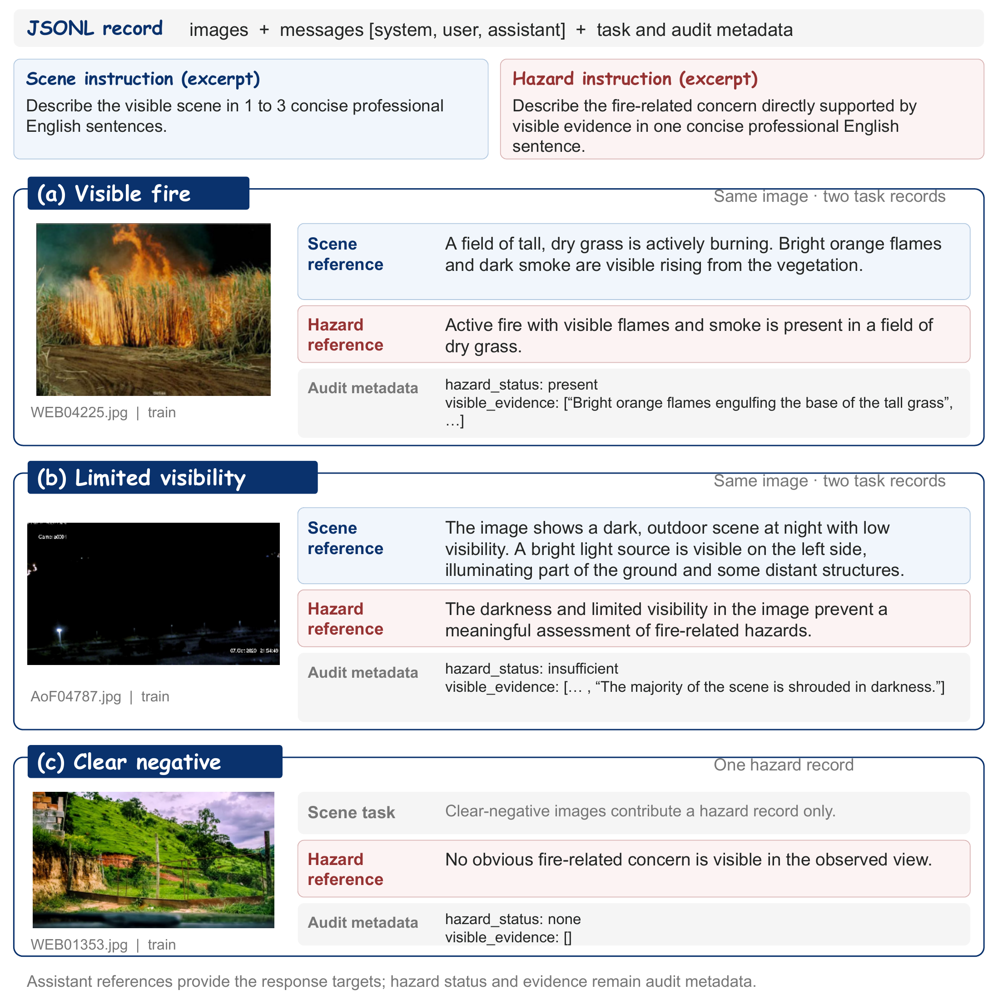
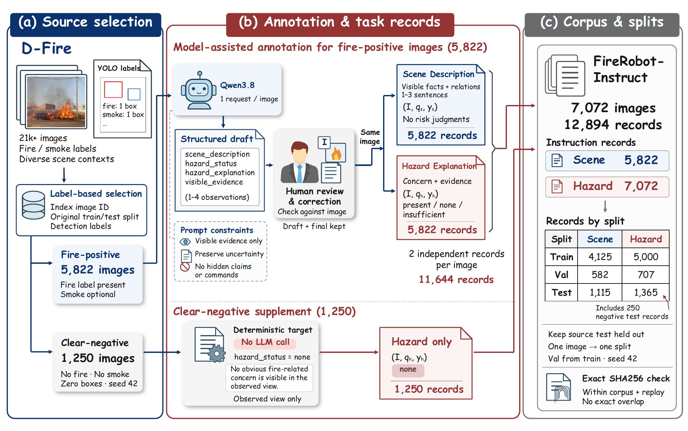

# FireSense 与 FireRobot-Instruct

FireSense 研究如何让紧凑视觉语言模型在资源受限边缘设备上生成火场报告。我们构建的 **FireRobot-Instruct** 数据集包含两个互补任务：**事实性场景描述**与**可见火灾相关风险解释**。

**发布状态：完整 FireRobot-Instruct 数据集将在论文发表后于本仓库公开发布，并提供标注说明和图像级数据划分清单。** 当前主页介绍数据集内容、构建方法与代表性范例。

[English](README.md) · [详细数据说明](DATASET_CARD.md) · [项目仓库](https://github.com/HTZ2025/FireSense)

## 数据规模

| 项目 | 数量 |
|---|---:|
| 图像 | 7,072 |
| 指令记录 | 12,894 |
| 场景描述记录 | 5,822 |
| 风险解释记录 | 7,072 |

图像来自 D-Fire。我们在选定图像上增加任务指令、参考报告和审计信息。每张火灾阳性来源图像提供一条场景描述记录和一条风险解释记录；清晰阴性图像仅提供一条风险解释记录。报告语言为英语。

## 数据范例

蓝色区域为场景描述，红色区域为风险解释，灰色区域为审计元数据。模型使用最终回答文本进行监督训练；风险状态和可见证据说明用于审计与评估。

## 构建流程

1. **来源筛选：** 根据 D-Fire 检测标注选择 5,822 张至少含一个火灾标注的图像，并选择 1,250 张无火、无烟且检测框数量为零的清晰阴性图像。
2. **生成标注草稿：** 对每张火灾阳性来源图像调用一次 Qwen3.8-Flash，生成场景描述、风险状态、风险解释与可见证据列表。
3. **人工审核修正：** 对照图像审核草稿，形成最终标注；每张审核后的图像生成两个独立任务记录。
4. **补充阴性记录：** 清晰阴性图像根据来源标签获得标准化的“未见明显火灾相关风险”回答，并单独记录标注来源。
5. **校验与划分：** 检查记录结构、标识符和任务配对。保留原始测试侧图像作为测试集，从训练侧划出验证集；同一图像的所有记录归入同一集合，随后再执行模型输入缩放。使用 SHA256 检查精确内容重叠。

## 数据划分

| 集合 | 图像 | 场景记录 | 风险记录 | 全部记录 |
|---|---:|---:|---:|---:|
| 训练 | 5,000 | 4,125 | 5,000 | 9,125 |
| 验证 | 707 | 582 | 707 | 1,289 |
| 测试 | 1,365 | 1,115 | 1,365 | 2,480 |
| 合计 | 7,072 | 5,822 | 7,072 | 12,894 |

测试集包括 1,115 张火灾阳性来源图像和 250 张清晰阴性图像。DetectiumFire 的辅助描述数据单独统计，不计入上述数据规模。

## 三种风险参考状态

- **Present：** 可见证据支持识别出明确的火灾相关风险。
- **None：** 场景具有充分可观测性，但未发现明显的火灾相关风险。
- **Insufficient：** 黑暗、距离、模糊或遮挡等因素使图像不足以支持有意义的风险评估。

已观察到明确风险时，对其原因、范围或严重程度的不确定不会将其变成 insufficient。Insufficient 表示可评估性不足，而非较低的风险严重程度。

三种状态分别包含 5,391、1,393 和 288 条记录，其中 insufficient 的训练、验证和测试数量分别为 208、33 和 47。评估中的 unresolved 表示无法从模型回答中确定状态，不是新增的训练类别。

## 论文发表后的开放内容

计划公开完整指令标注与审计元数据、图像身份及固定划分清单、标注规范、数据准备说明，以及训练和评估代码。源图像访问和归属遵循 D-Fire 的上游条款；新增标注及代码的条款将在发布时分别说明。

## 来源与致谢

- [D-Fire](https://github.com/gaia-solutions-on-demand/DFireDataset)：源图像与火烟检测标注。
- [DetectiumFire](https://github.com/ZixuanLiu4869/DetectiumFire)：训练路线实验中使用的独立辅助图像描述数据。

感谢上述资源的创建者。FireRobot-Instruct 在选定图像上构建任务化报告监督、记录组织方式和评估划分。
